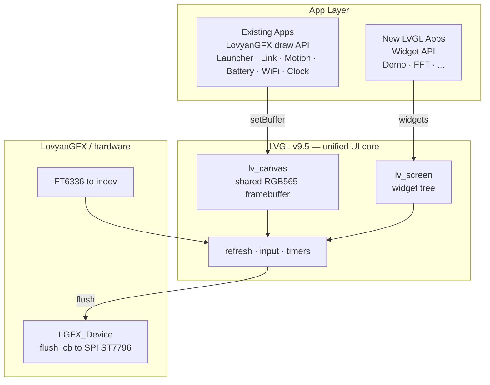

<p align="center">

</p>

<h1 align="center">Pocket35</h1>

<p align="center">
A 3.5-inch ESP32-S3 pocket device with a Mooncake app-framework UI, onboard sensors (IMU / RTC / PMIC), BLE and Wi-Fi provisioning.
</p>

---

## Features

- **App-framework UI** built on [Mooncake](https://github.com/Forairaaaaa/Mooncake), with a smooth animated launcher
- **BLE link** via NimBLE-Arduino (KT6368A bridge)
- **Onboard sensors**: 6-axis IMU (QMI8658), RTC (PCF85063), battery PMIC (AXP2101)
- **Wi-Fi provisioning** via captive portal (SoftAP + DNS hijack) with a mobile-friendly page
- **Rachel-style HAL**: single-instance HAL with static forwarding and a board/simulator split
- **LVGL-based rendering**: LVGL v9.5 is the unified UI core; existing apps keep their LovyanGFX draw code on a shared framebuffer, new apps use LVGL widgets

## Architecture

LVGL is the single rendering/input base. Existing apps keep their LovyanGFX draw calls (the sprite is rebound to an `lv_canvas` framebuffer), while new apps are written with LVGL widgets. Both are flushed to the same SPI panel through one LVGL display driver.



## Apps

| App | Description |
| --- | --- |
| Launcher | Animated icon grid with a status bar (clock + battery) |
| Link | Bluetooth link / bridge |
| Motion | Real-time accel / gyro plus roll / pitch / yaw |
| Battery | Voltage, chip temperature, charge state, VBUS |
| WiFi | Provisioning through a captive portal |
| Clock | Large clock + date/weekday with RTC NTP sync |
| LVGL Demo | LVGL widgets (label / slider / button) to validate coexistence |
| FluidBox | Particle fluid simulation driven by the IMU and touch |
| Lucky Wheel | Two-stage spin wheel with an option selector |
| Audio FFT | 20-band radial spectrum from the ES8311 microphone |
| Watch Face | Four swappable dials: classic, number flow, big number, minimal |
| Template | App scaffold for quick iteration |

## Onboard peripherals

| Chip | Function | I2C address |
| --- | --- | --- |
| QMI8658 | 6-axis IMU | 0x6B |
| PCF85063 | RTC | 0x51 |
| AXP2101 | PMIC / battery | 0x34 |
| ES8311 | Audio codec (mic + speaker) | 0x18 |
| TCA9554 | GPIO expander | 0x20 |
| FT6336 | Touch controller | 0x38 |

## Getting started

Build and upload with PlatformIO:

```sh
pio run -t upload --upload-port COMx
```

## Simulator

Runs the same app code on a Linux desktop through SDL2, so the LVGL UI can be previewed without the board. `HAL_Simulator` supplies the panel, maps the mouse to touch input and feeds the wall clock to the RTC layer; board code under `hal_board/` is excluded from the build.

**Prerequisites (Ubuntu)**

```sh
sudo apt install build-essential cmake git pkg-config libsdl2-dev
```

**Build and run**

```sh
bash sim/setup_deps.sh                    # clone LovyanGFX / LVGL 9.5 / Mooncake into third_party
mkdir -p build && cd build
cmake .. -DCMAKE_BUILD_TYPE=Release
make -j8
./pocket35_sim
```

| Step | What it does |
| --- | --- |
| `sim/setup_deps.sh` | Clones the pinned deps into `third_party/`: LovyanGFX `master`, LVGL `release/v9.5`, Mooncake `v2.3.3`. Tries the `ghfast.top` mirror first, falls back to GitHub. Safe to re-run. |
| `cmake ..` | Compiles the app sources plus `lib/` libraries against SDL; `include/lv_conf.h` is reused as the LVGL config. |
| `make -j8` | Produces `build/pocket35_sim`, no cross toolchain involved. |

Drag with the mouse to swipe between apps, click an icon to launch it, and press **Space** to emulate the BOOT key on the board. `sim/compat/` holds the Arduino / ESP-IDF shims, and `sim/sdl_compat.*` patches the two SDL calls LovyanGFX needs that are missing from SDL 2.0.10 (Ubuntu 20.04's default).

## License

Licensed under the [Apache License 2.0](LICENSE).
