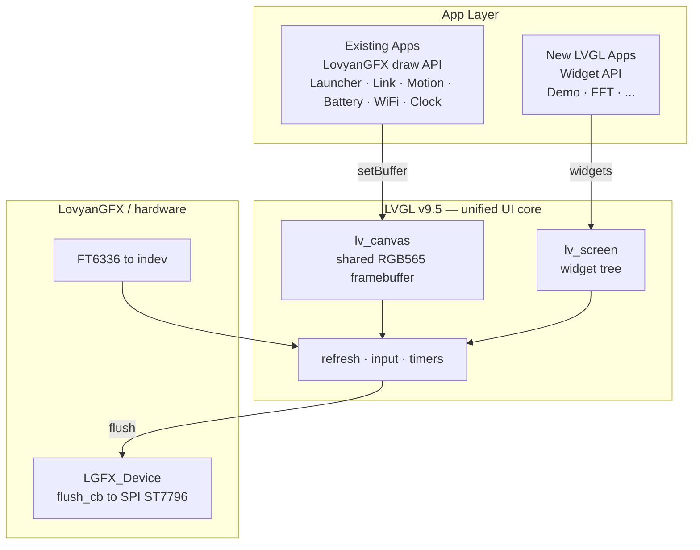

<p align="center">

</p>

<h1 align="center">Pocket35</h1>

<p align="center">
A 3.5-inch ESP32-S3 pocket device with a Mooncake app-framework UI, onboard sensors (IMU / RTC / PMIC), BLE and Wi-Fi provisioning.
</p>

---

## Features

- **App-framework UI** built on [Mooncake](https://github.com/Forairaaaaa/Mooncake), with a smooth animated launcher
- **BLE link** via NimBLE-Arduino (KT6368A bridge)
- **Onboard sensors**: 6-axis IMU (QMI8658), RTC (PCF85063), battery PMIC (AXP2101)
- **Wi-Fi provisioning** via captive portal (SoftAP + DNS hijack) with a mobile-friendly page
- **Rachel-style HAL**: single-instance HAL with static forwarding and a board/simulator split
- **LVGL-based rendering**: LVGL v9.5 is the unified UI core; existing apps keep their LovyanGFX draw code on a shared framebuffer, new apps use LVGL widgets

## Architecture

LVGL is the single rendering/input base. Existing apps keep their LovyanGFX draw calls (the sprite is rebound to an `lv_canvas` framebuffer), while new apps are written with LVGL widgets. Both are flushed to the same SPI panel through one LVGL display driver.



## Apps

| App | Description |
| --- | --- |
| Launcher | Animated icon grid with a status bar (clock + battery) |
| Link | Bluetooth link / bridge |
| Motion | Real-time accel / gyro plus roll / pitch / yaw |
| Battery | Voltage, chip temperature, charge state, VBUS |
| WiFi | Provisioning through a captive portal |
| Clock | Large clock + date/weekday with RTC NTP sync |
| LVGL Demo | LVGL widgets (label / slider / button) to validate coexistence |
| FluidBox | Particle fluid simulation driven by the IMU and touch |
| Lucky Wheel | Two-stage spin wheel with an option selector |
| Audio FFT | 20-band radial spectrum from the ES8311 microphone |
| Template | App scaffold for quick iteration |

## Onboard peripherals

| Chip | Function | I2C address |
| --- | --- | --- |
| QMI8658 | 6-axis IMU | 0x6B |
| PCF85063 | RTC | 0x51 |
| AXP2101 | PMIC / battery | 0x34 |
| ES8311 | Audio codec | 0x18 |
| TCA9554 | GPIO expander | 0x20 |
| FT6336 | Touch controller | 0x38 |

## Getting started

Build and upload with PlatformIO:

```sh
pio run -t upload --upload-port COMx
```

## License

Licensed under the [Apache License 2.0](LICENSE).
